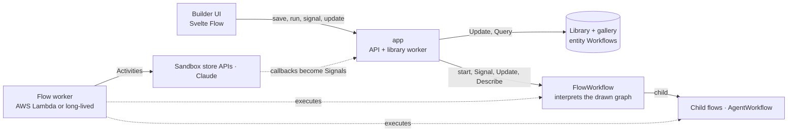

# Visual Workflows

A visual workflow builder where every flow you draw runs as a durable Temporal Workflow, on workers that scale to zero.

- **Steps that call out** are [Activities](https://docs.temporal.io/activities). Each step has its own [retry policy](https://docs.temporal.io/encyclopedia/retry-policies) and timeouts, which it can inherit from the flow. Steps can also carry an undo request, so a failed run compensates in reverse order (a [saga](https://docs.temporal.io/design-patterns/saga-pattern.md)).
- **Events from outside** arrive as [Signals](https://docs.temporal.io/sending-messages#sending-signals). Every run has a callback URL, and a POST to it is the same as sending the Signal from the Temporal UI.
- **Event lanes:** an *On signal* lane runs once per event. An *On update* lane runs for a validated [Update](https://docs.temporal.io/sending-messages#sending-updates) and returns its *Respond* step's value to the caller. Lanes change the run's variables while the main path is mid-flight. Visible variables are readable through a Query.
- **Waiting is free:**
  - *Wait for signal*, *Wait for condition*, approvals, and timers all hold the run with no compute.
  - Timers can be a fixed amount, or an expression that recalculates when a lane changes a variable.
  - *First of* races branches and cancels the losers.
- **Composition:** *Run flow* and *For each* run other saved flows as [child Workflows](https://docs.temporal.io/child-workflows). Keyed flows keep one long-lived run per key ([entity pattern](https://docs.temporal.io/design-patterns/entity-workflow.md)) and [continue as new](https://docs.temporal.io/workflow-execution/continue-as-new) to stay small.
- **Triggers:** a manual start, a webhook, or a [Schedule](https://docs.temporal.io/schedule) (an interval, cron with a time zone, or weekdays and a time).
- **AI agent:** a Claude ReAct loop as a child Workflow. Every model turn and tool call is a durable step, and the agent can stop to ask a person.
- **Platform:**
  - An overview, workflows, executions, schedules, and a template gallery.
  - Templates can be shared with everyone or by private link.
  - Version history, and flows laid out left-to-right or top-down.
  - Saved flows live in Temporal itself (an entity Workflow per user), with no database.

## How it works



`FlowWorkflow` (`internal/workflows`) is a small interpreter:

- **One snapshot per run.** Each run receives a snapshot of its flow, so editing a flow never touches runs in flight. Every `case` in `nodes.go` is the Temporal primitive behind one step type.
- **Main path and lanes.** A flow has one main path from its trigger, and lanes from *On signal* and *On update* entries.
  - A step runs once all its incoming edges are decided, so branches and joins need no extra step types. *First of* is the exception: it fires on the first branch to arrive.
  - Lanes share the run's variables, events, and step outputs.
  - Everything runs on one deterministic event loop, so lanes never interleave mid-step.
- **Expressions are deterministic.** Templates like `{{ steps.create_order.body.id }}`, `{{ vars.address }}`, and `{{ events.order_status.status }}` are evaluated in the Workflow, with the clock disabled, so replays always agree.
- **The run view never wakes a worker.** The Workflow keeps a compact progress record in its memo. The API reads that record, the flow snapshot from the run's first history event, and retry attempts from `DescribeWorkflowExecution`. None of these need a running worker, so watching a run costs nothing on serverless. Step outputs are fetched on demand with a Query.
- **Worker Versioning, no patching.** Flow runs are **Pinned** to the worker build they started on. Keyed runs move to the newest build when they continue as new.

## The example flows

New users start with these flows. The same flows appear as built-in templates.

| Flow | What to show |
|---|---|
| **Order shipped notification** | Event-driven waiting. The store gets the run's callback URL and reports each status change as an `order_status` Signal. The run sleeps until one says `shipped`. |
| **Resilient payment capture** | A retry policy. The gateway fails three times; the step shows *Attempt 4 of 6*. The bank's settlement callback then arrives as a Signal. |
| **Refund approval** | A person decides, through an Update with a validator. A timeout escalates; it never counts as a rejection. Triggered by a webhook. |
| **Editable order** (top-down) | Lanes change the address or cancel the order. `extend_hold` is an Update that answers with the new hold length. The hold timer recalculates, and a *First of* race either ships or cancels. |
| **Trip booking (saga)** | The card declines, so the hotel and flight undo requests run in reverse order. |
| **Daily stock report** | A calendar Schedule: weekdays at 9:00 New York time, with pause and run-now. |
| **Customer loyalty (keyed)** | One run per customer. Purchases arrive with Signal-With-Start. Points and tier live in variables. The run continues as new to stay small. |
| **Ship to many customers** | *For each* runs *Order shipped* as child Workflows, two at a time. |
| **AI support triage** | A Claude agent uses HTTP tools, asks a person before a large refund, and returns JSON that later steps branch on. |

Moments worth showing:

- **Change a run while it waits.** Open *Editable order*, send `change_address`, then extend the hold with an Update. The Update's response comes back in the run view, and the timer moves.
- **Crash a worker.** Start *Resilient payment capture* and run `make crash-worker`. The run view keeps showing its progress while no worker is running. Run `make worker` and the run carries on from the same step.

## Run it

You need Go 1.27, Node 24, and the [Temporal CLI](https://docs.temporal.io/cli). To use the agent step, export `ANTHROPIC_API_KEY`.

```sh
cd web && npm install && cd ..
make dev
```

| URL | What |
|---|---|
| http://localhost:5173 | Builder (Vite dev server) |
| http://localhost:8080 | Builder embedded in the app binary (after `make web`) |
| http://localhost:8233 | Temporal UI |

| Command | Does |
|---|---|
| `make dev` | Starts the Temporal dev server, sandbox, flow worker, app, and UI. Ctrl-C stops them all. |
| `make crash-worker` | `kill -9` the flow worker |
| `make worker` | Starts a flow worker in the foreground |
| `make test` | Go tests (the Workflow test suite) and `svelte-check` |
| `make docker` | The same stack in containers |

### Configuration

Every process reads Temporal settings from the standard environment variables (`TEMPORAL_ADDRESS`, `TEMPORAL_NAMESPACE`, `TEMPORAL_API_KEY`, `TEMPORAL_TLS_*`) and ignores the CLI config file.

| Variable | Used by | Default |
|---|---|---|
| `TASK_QUEUE` | app, workers | `visual-workflows`; the library uses `<TASK_QUEUE>-library` |
| `TEMPORAL_WORKER_DEPLOYMENT_NAME`, `TEMPORAL_WORKER_BUILD_ID` | workers | `visual-workflows`, `local` |
| `WORKER_SET_CURRENT_VERSION` | worker | unset; `make dev` sets it to `true` so the local build becomes current |
| `WORKER_MODE` | app | `long-lived`; `serverless` changes the worker indicator |
| `ANTHROPIC_API_KEY`, `ANTHROPIC_MODEL` | workers | unset (agent steps fail clearly); `claude-opus-5-5` |
| `SANDBOX_URL` | app | `http://localhost:8090`, written into the example flows |
| `CALLBACK_BASE_URL` | app | the request's host; set it when callers reach the app on an internal address |
| `TEMPORAL_UI_URL` | app | `http://localhost:8233` |
| `SESSION_SECRET` | app | `make dev` sets a fixed local value; set your own when running more than one replica |
| `TRUST_AUTH_HEADERS` | app | `false`; set it to `true` only behind the catalog's SSO ingress |

## Notes

- **Users and sharing.** Each browser is a user, through a signed cookie, or the catalog's signed-in identity when `TRUST_AUTH_HEADERS` is set.
  - Every Workflow ID starts with `vflow-<task queue>-<user>-`, and the API refuses IDs outside the caller's prefix.
  - Signed-in users keep their flows. Anonymous sessions end after 30 idle days.
  - Templates are copies. Publishing lists a template for everyone; a share link reaches it privately; only the author can unpublish.
- **Waiting on events, not polling.** Outside systems resume a run with a POST to its callback URL. Nothing polls.
- **Lane semantics.**
  - A failed step in a signal lane marks that step failed, and the run continues.
  - A failed Update lane returns the error to the caller.
  - A run finishes when its main path does, after any lanes already running have finished.
- **Serverless.**
  - `cmd/lambda-worker` runs the same Workflows on AWS Lambda through `lambdaworker`. Activity attempts are capped at 600 s so they fit inside an invocation.
  - The app (UI, API, and library worker) stays always on.
  - Locally, the long-lived `cmd/worker` stands in, which keeps the crash moment.
- **Catalog.** `deploy/demoproject.yaml` is a draft `DemoProject` with an isolated Lambda workspace. It passes the registry's `validate_projects.py` and has not been submitted.
  - One platform gap: Lambda workers can't reach in-cluster services, and ingress auth applies to the whole project. The sandbox therefore needs a URL that Lambda can reach.
